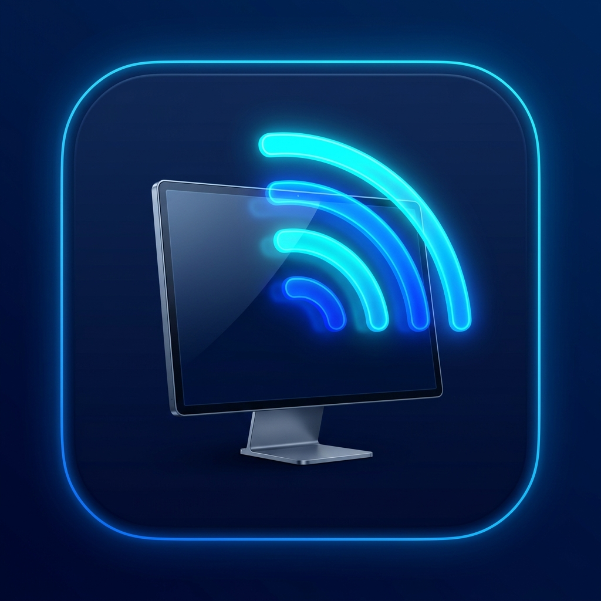

<p align="center">
  
</p>

# Multi_Instance_CRD

[-blue.svg)](https://github.com/zaczzk/Multi_Instance_CRD)
[](https://github.com/zaczzk/Multi_Instance_CRD/actions/workflows/build.yml)
[](LICENSE)

A small Windows app for using **Chrome Remote Desktop** with several computers at once: each one gets its own session, without browser tabs, address bars or borders in the way.

Runs natively on **Windows on ARM (Snapdragon X)** and **x64 (Intel / AMD)**.

> Not affiliated with Google. It hosts the regular Chrome Remote Desktop web app (remotedesktop.google.com) in Microsoft Edge WebView2 and signs in with your normal Google account.

---

## Features

- **Three sessions, instant switching.** Each slot stays connected in the background; switch with a click or `Ctrl + Alt + 1/2/3`.
- **Split view.** Two sessions side by side, with a draggable divider.
- **Auto-hiding top bar.** Rest the pointer at the top edge of the window to show it. Pin it if you prefer it always visible.
- **Live status.** Each session tab shows connected / connecting / not connected. Hover a tab for latency, frame rate and a preview of background sessions.
- **Reconnects where you left off.** Each slot remembers the last computer it connected to.
- **Send keys** such as Ctrl + Alt + Del, Ctrl + Shift + Esc and the Windows key to the remote computer.
- **Saves power.** Video in background sessions is paused (the connection stays open), and only the focused session plays sound.
- **Tray mode.** Closing the window keeps it running in the tray; `Ctrl + Alt + R` brings it back from anywhere.

---

## Download

Get the latest version from [**GitHub Releases**](https://github.com/zaczzk/Multi_Instance_CRD/releases):

| Package | What it is |
| :--- | :--- |
| **Setup (.NET included)** — recommended | Installer with everything it needs. |
| **Setup (Lightweight)** | Much smaller installer if you already have the [.NET 9 Desktop Runtime](https://dotnet.microsoft.com/download/dotnet/9.0). |
| **Portable ZIP** | No installation. Extract and run `Run-CRD.cmd`. |

The installer updates an existing installation in place and warns before installing an older version.

---

## Shortcuts

These work while the app is in front. They use `Ctrl + Alt` so they rarely clash with apps on the remote computer.

| Shortcut | Action |
| :--- | :--- |
| `Ctrl + Alt + 1` / `2` / `3` | Switch to session 1, 2 or 3 |
| `Ctrl + Alt + Tab` | Next session |
| `Ctrl + Alt + C` | Split view on / off |
| `Ctrl + Alt + F` | Fullscreen on / off |
| `Ctrl + Alt + B` | Show / hide the top bar |
| `Ctrl + Alt + R` | Show / hide the app (works from anywhere) |

To fill the window without black bars, turn on **Resize desktop to fit** in Chrome Remote Desktop's own side panel (the arrow on the right edge of the session). The same panel picks which of the remote computer's monitors to show.

---

## Settings

Open **Settings** from the gear on the top bar or from the tray icon menu. You can name each session (leave it blank to use the remote computer's name), set its start page, and choose whether background video pauses, whether the bar stays pinned, and how the window starts.

Settings and sign-in data are stored in `%LOCALAPPDATA%\CRDLightweightARM\`. Problems are logged to `crash.log` in the same folder.

---

## Building from source

Requirements: Windows 10/11 and the [.NET 9 SDK](https://dotnet.microsoft.com/download/dotnet/9.0).

```cmd
:: Build and run (add -Arch x64 on Intel / AMD)
build.cmd -Run

:: Build all release packages and installers (installers need Inno Setup 6)
powershell .\build.ps1 -BuildInstallers -Version 1.2.0
```

---

## License

[MIT](LICENSE). Copyright (c) 2026 zaczzk.
